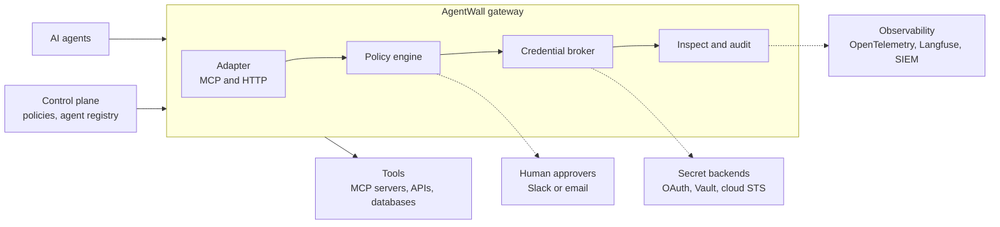

# AgentWall

**An open-source, self-hosted security gateway that sits between AI agents and their tools. It enforces who can do what, on whose authority, and keeps a tamper-evident record of every action.**

> **Status: pre-alpha, planning phase.** Nothing described below is released yet. This README explains what we are building and why. The roadmap and open issues show where things stand. "AgentWall" is a working name and may change.

---

## Why this exists

AI agents are moving from demos into production, where they read tickets, change code, query databases, and call internal APIs. Most of them do this with broad, long-lived credentials and no consistent way to answer basic questions:

- What did the agent do, and was it allowed to?
- Whose authority was it acting under: the user's, its own, or another agent's?
- If a user lacks access to something, can an agent with access quietly do it on their behalf?
- If Agent A asks Agent B to fetch data that A cannot see, what stops B from handing it over?

Security and compliance teams are blocking agent rollouts because there are no good answers. AgentWall is an attempt to provide them in an open, auditable, self-hostable form, so organizations (including those that need data to stay on-premises or in-country) can adopt agents with confidence.

## What it does

AgentWall is a proxy that every agent-to-tool call passes through. For each call it:

1. **Identifies** the caller: the agent, the end user, and any agents in between.
2. **Decides** whether to allow, deny, or require human approval, based on policy.
3. **Brokers credentials** so agents never hold real secrets. Upstream tools receive short-lived, narrowly scoped tokens.
4. **Inspects** inputs and outputs for prompt injection, secrets, and personal data. 5. **Records** the decision in a tamper-evident audit log and emits OpenTelemetry traces.

## Core ideas

- **Effective permission = user ∩ agent.** If the agent can write to a repository but the user cannot, the call is denied. Agent-to-agent chains only ever shrink permissions: user ∩ Agent A ∩ Agent B.
- **Fail closed.** If the policy engine, credential broker, or audit log is unavailable, the call is denied.
- **Agents never see real secrets.** The gateway mints short-lived, scoped credentials per call.
- **Every decision is explainable.** Audit records say what was decided, by which policy, and why.
- **Change policies without fear.** Replay candidate policies against recorded traffic, and run new policies in shadow mode before enforcing them.
- **Built to scale to organizations.** Layered policies (org guardrails, team rules, per-agent manifests) so thousands of agents do not mean thousands of hand-written rules.

An example of the kind of rule we want to make easy to write (illustrative; the policy language is still being decided):

> _Support agents may read tickets. They may write only to the staging environment. Any delete requires approval from a team lead. No agent may call a tool outside its team's allow list._

## Planned features

| Area              | What is planned                                                                                     |
| ----------------- | --------------------------------------------------------------------------------------------------- |
| **Gateway**       | MCP (stdio and HTTP) proxy with a swappable protocol layer, streaming-safe, fail closed             |
| **Policy**        | Attribute-based policies, a `policy test` CLI, explainable decisions, shadow mode, replay simulator |
| **Identity**      | Workload identity for agents, end-user identity passthrough, agent-to-agent delegation chains       |
| **Credentials**   | Token broker with OAuth token exchange, then Vault and AWS STS backends                             |
| **Approvals**     | Human-in-the-loop approvals via Slack, with signed decision records                                 |
| **Audit**         | Hash-chained, tamper-evident log with signed checkpoints and a `verify` command                     |
| **Observability** | OpenTelemetry export, with a Langfuse and Grafana demo stack                                        |
| **Detection**     | Pluggable detectors for prompt injection, secrets, and PII                                          |
| **Operations**    | Control plane API, signed policy bundles, Helm chart, high availability                             |

## Roadmap

The project is planned as a twelve-month effort, tracked in Linear with one project per phase.

| Phase                       | Focus                                                                                 |
| --------------------------- | ------------------------------------------------------------------------------------- |
| **0. Foundations**          | Repo setup, MCP study, policy engine and language decisions, threat model, benchmarks |
| **1. Core proxy**           | Passthrough MCP proxy, Action model, static rules, audit log v0                       |
| **2. Policy and identity**  | Policy schema and engine, agent and user identity, `user ∩ agent` enforcement         |
| **3. v0.1 launch**          | Token broker, approvals, tamper-evident audit, OpenTelemetry, first public release    |
| **4. Production hardening** | Delegation chains, replay, policy manifests, control plane, HA, load testing          |
| **5. v1.0**                 | Detectors, audit viewer and SSO, stable APIs, independent security review             |

## Non-goals (for now)

- A model gateway or LLM router. AgentWall governs agent-to-tool traffic, not model calls, and is meant to sit beside tools like LiteLLM rather than replace them.
- A full management web UI before v1.0. We start with an API and CLI.
- A guarantee against every attack. Prompt-injection detection is probabilistic and is a defense layer on top of policy, not a replacement for it.
- Visibility into data an agent holds inside its own model context. The gateway can only govern what crosses it.

## Getting started

There is nothing to install or setup yet. To follow along:

- **Watch or star the repository** for release announcements.
- **Read the open issues** to see what is being worked on.
- **Join the discussion** (GitHub Discussions will open before the v0.1 launch).

## Contributing

Contributions are welcome, including design feedback at this stage.

- Read `CONTRIBUTING.md` for development setup and pull request expectations.
- Sign off your commits under the [Developer Certificate of Origin](https://developercertificate.org/) (`git commit -s`).
- If you work in security or platform engineering, we would especially value hearing how your organization controls agent access today and what blocks your rollout.

## Security

AgentWall is a security product, so we take reports seriously. Please do not open public issues for vulnerabilities. See `SECURITY.md` (coming in Phase 0) for the private reporting process. The threat model will be published in `docs/threat-model.md` and kept current as the project evolves.

## License

Apache License 2.0. See `LICENSE`.
