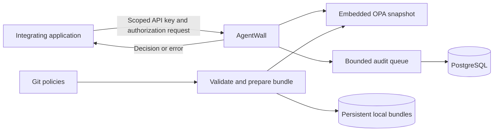

# AgentWall

An open-source, self-hosted authorization policy engine and audit service for AI applications.

**Status: pre-alpha foundation scaffold.** The capabilities below describe the planned v0.1 release; they are not implemented or released yet.

Our first focus is policy evaluation and audit. AgentWall will answer whether an application should permit an action and record the authorization decision. Integrating applications must enforce that decision and block actions on errors or timeouts.

## First release: policy and audit

- Embedded OPA with declarative, versioned YAML policies.
- Explicit deny overrides allow; default deny.
- Scoped API keys and validation of the attributes each caller may assert.
- REST authorization responses containing decision ID, outcome, reason, and policy revision.
- Git-managed policies with validated, atomic activation, persistent bundles, and rollback.
- Bounded asynchronous auditing to PostgreSQL, with REST and CLI queries.
- Structured logs, metrics, traces, and Docker Compose deployment.

Strict audit mode will reject requests when their decision events cannot be accepted into the queue. An in-memory queue cannot guarantee audit survival across crashes. Audit events describe authorization decisions, not proof of upstream execution or tamper-evident history.

## Architecture and boundary

The application authenticates its users, supplies assertions within its configured trust scope, and enforces the response. AgentWall authenticates the calling service; v0.1 does not independently verify end-user permissions or delegation chains.

## Direction

1. **Policy and audit:** a complete, deployable v0.1 service.
2. **AI gateways:** evaluate LLM, MCP, and agent-to-agent integrations independently after v0.1.
3. **Secure agent runtime:** consider isolation, workload identity, and network enforcement later.

Gateway forwarding, credential brokerage, human approvals, permission-intersection guarantees, tamper-evident audit, and sandboxing are outside v0.1. Later-stage capabilities require their own design review.

The objective is engineering mastery through a limited, complete system: correctness, security boundaries, concurrency, failure handling, and operations before expansion.

## Project documents

- [Requirements](docs/requirements.md)
- [Architecture](docs/architecture/v0.1.md)
- [Roadmap](docs/roadmap.md)
- [Direction decision](docs/ADRs/003-policy-audit-first.md)
- [Threat model](docs/threat-model.md)
- [Benchmark conditions](docs/benchmark-conditions.md)
- [Support matrix](docs/support-matrix.md)

## Development and contributions

See [development setup](docs/development.md) for the current scaffold and build commands, and [CONTRIBUTING.md](CONTRIBUTING.md) for contribution expectations. Sign off commits under the Developer Certificate of Origin (`git commit -s`). Report vulnerabilities privately using [SECURITY.md](SECURITY.md).

## License

Apache License 2.0. See [LICENSE](LICENSE).
