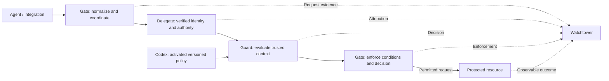

# AgentWall architecture

AgentWall is one deployable service with five separated internal modules:

| Modules | Responsibility |
| --- | --- |
| **Gate** | Intercept and normalize requests, coordinate with other modules for authorization, enforcement and trace, and forward permitted actions. |
| **Delegate** | Verify agent identity, represented principal (user), the source and scope of delegated authority (resource). |
| **Guard** | Evaluate policies against trusted context and return decisions and required approvals or obligations. |
| **Codex** | Define, validate, test, version and activate policies; reuse Guard's evaluator for policy tests. |
| **Watchtower** | Trace and record the actions of AgentWall in a temperproof audit trail |

## Workflow

- AgentWall Gate accept the agents request, validates the incoming request and normalize the request
- AgentWall Delegate read the normalized request, identify agent, principal (user), action and resource. It connects with the external Identity provider to identify the user and agent
- AgentWall Guard evaluates the authenticated user and agent with the set policy. AgentWall Codex provide the policy to Guard. Guard returns either allow, deny, or unknown.
- AgentWall Gate enforce the decision received from Guard to either allow or deny the request. Appropriate status is sent to the agent.
- AgentWall Watchtower monitors and observe all the actions taken by the modules, create a tracable audit trail

The agent, represented principal and authority source are distinct; the latter two may differ, and an agent need not have an initiating human. Integrate with existing identity/secrets infrastructure rather than building replacements.

Guard evaluates an activated versioned snapshot; policy management need not run synchronously per request. Organization/team combination, inheritance and conflict semantics require explicit v0.4.0 design. Project/agent scopes are architecture considerations without fixed timing. Historical policy specifications are archived and do not define the new scope semantics. Reuse requires explicit reconciliation during design.

Internal interfaces, protocols, provider selection, audit schemas/storage/delivery, activation mechanics and approval/action binding remain milestone design work. See [open decisions](open-decisions.md) for the design backlog.
