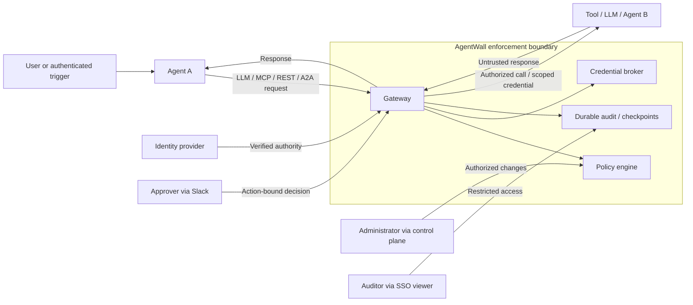

# AgentWall threat model — STRIDE

## Scope and boundaries

One organization per deployment. Agents, requests, tool responses, and network peers are untrusted. Attackers may impersonate callers, control an agent or upstream, replay messages, or overload the gateway. 
Administrators and signing infrastructure are privileged trust dependencies.

Protected assets: user/agent authority, delegation chains, policies, approval decisions, upstream credentials, request/response data, audit evidence, and signing keys.

External identity, approval, administration, upstream, and audit-access flows each cross a trust boundary. Agent B's subsequent calls must pass through the gateway with the full initiating authority and delegation chain.

## STRIDE threats

| Category | Threat | Mitigation / requirement | Planned validation |
| --- | --- | --- | --- |
| Spoofing | Forged user/agent identity, delegation, or Slack approver. | Authenticate and bind assertions to requests; validate issuer, expiry, chain provenance, and approver eligibility. FR-06–09, FR-16–18. | Reject forged headers, expired assertions, omitted chain members, and unauthenticated callbacks. |
| Tampering | Altered actions, policy, approvals, or audit records. | Validate requests; restrict/version policy changes; bind approvals to exact actions; hash-chain audit records with signed trusted checkpoints. FR-05, FR-12, FR-17, FR-19. | Reject altered approvals and unauthorized policy changes; detect changed/reordered records and checkpoint-covered truncation. |
| Repudiation | Caller, approver, or administrator denies an operation. | Record authority, action, policy version, reason, approval signature, and execution outcome; durably record decisions before forwarding. FR-20–21. | Correlate each action with evidence; simulate crashes and distinguish unknown outcomes from confirmed execution. |
| Information disclosure | Secrets or protected data leak through responses, logs, telemetry, or malicious destinations. | Inject scoped credentials only upstream; protect transport/storage; redact outputs; enforce team access and destination restrictions. FR-05, FR-08, FR-14, FR-23, NFR-02–03, NFR-11. | Check credential leakage, cross-team reads, redirects/SSRF, and optional external exports. |
| Denial of service | Oversized inputs, excessive streams, expensive policy, or dependency/storage exhaustion. | Bound payloads, concurrency, execution time, and queues; expose health; fail closed when required security dependencies fail. FR-05, FR-15, FR-21, NFR-01, NFR-07. | Overload and cancel streams; interrupt policy/broker/audit/approval services; verify bounded resources and no unauthorized forwarding. |
| Elevation of privilege | A stronger agent launders authority; replayed approvals or team rules bypass guardrails. | Intersect initiating authority with every agent; reject invalid delegation; prevent weaker rules and approvals overriding guardrails; revalidate before execution. FR-08–11, FR-17–18, FR-30. | Deny user → Agent A → Agent B escalation, cyclic/replayed chains, duplicate approvals, and actions revoked while pending. |

## Assumptions and residual risks

- Operators must block direct agent access to upstream tools and credentials. Traffic bypassing AgentWall cannot be governed.
- Prompt injection can cause policy-permitted misuse; detectors are excluded. Model-context data and actions outside gateway traffic remain invisible.
- Compromised administrators, gateway hosts, or signing keys can undermine controls. Hash chains alone cannot prove completeness; truncation evidence requires trusted external checkpoints.
- Upstream effects may occur before a crash prevents outcome recording. Unknown outcomes require reconciliation; retries cannot guarantee exactly-once execution.
- Identity/SSO mechanisms, credential backend, key custody/anchoring, retention defaults, and active-stream revocation behavior remain unresolved. These assumptions require review before production use.

## Review

Update this model when protocols, authority rules, integrations, deployment boundaries, or key/storage choices change; provide the reviewed version to the independent v1.0 security review (NFR-09, NFR-12).
