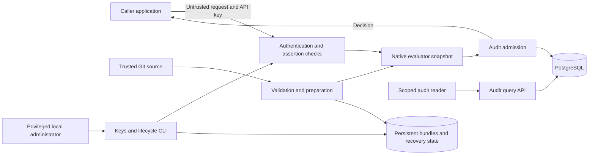

# AgentWall v0.1 threat model

Date: 2026-10-14
Status: Architecture baseline; refine alongside implementation contracts

## Assets and boundary

Protect caller credentials, authorization integrity, policy source and active bundles, administrative authority, audit confidentiality, and service availability. One organization and one service instance are in scope.

Untrusted applications submit requests to the REST service. API keys authenticate the calling service; principal, agent, resource, and context assertions are accepted only within configured trust constraints. External applications authenticate their users and enforce decisions. AgentWall cannot prevent a caller from ignoring a deny, bypassing integration, or lying within its granted assertion authority.

## Threats and validation

| Threat | Mitigation | Required evidence |
| --- | --- | --- |
| Caller spoofing or unauthorized identity assertion | Scoped keys; server-derived caller identity; explicit field/value assertion constraints | Forged/revoked keys and out-of-scope assertions fail; AUTH-01–03 |
| Policy bypass through missing values, negation, wildcards or invalid types | Strict schema, published truth tables, default deny, deny precedence, bounded conditions | Negative semantic fixtures and evaluation error tests; POL-01–04 |
| Partial reload, corrupt bundles or rollback silently undone | Validate/test/prepare before atomic activation; integrity checks; persisted pin/recovery state | Concurrent reload, failed candidate, corruption, restart and polling tests; LIFE-01–04 |
| Administrative escalation or key disclosure | Separate admin identity, least privilege, hashed secrets, protected local storage | Unauthorized admin actions fail; rotation and leakage tests; AUTH-01–03 |
| Audit loss or duplicates under outages/crashes | Bounded queue/retries, strict admission default, idempotent inserts, loss metrics | Saturation, retry exhaustion, outage and drain tests; AUD-01–02 |
| Audit disclosure or unsafe query/retention behavior | Scoped queries, parameterized storage access, data minimization, bounded cleanup | Cross-scope, injection, pagination, redaction and retention tests; AUD-03–04 |
| Resource exhaustion through inputs, policies, Git or database | Request/evaluation/concurrency/queue limits, timeouts, bounded background work | Overload and fault injection keep resources bounded; POL-03, OPS-01 |
| Git credentials, keys or request secrets leak via diagnostics | Restricted credentials and telemetry; redact/minimize inputs | No secrets in events/logs/traces/metrics; AUTH-01, AUD-03, OPS-01 |
| Network interception or exposed operations interfaces | Document TLS termination, protected database transport and restricted admin/metrics access | Deployment access and transport checks; OPS-02 |

## Assumptions and residual risks

- Trusted integrations may lie within their assertion permissions. v0.1 does not establish permission intersection or verified delegation.
- In-memory audit admission is not durable persistence. Strict mode can lose accepted events on process/host crash. PostgreSQL records are not tamper-evident; privileged deletion or alteration is not independently detectable.
- Decision events do not prove execution or execution outcome. The caller remains responsible for enforcing errors/timeouts and binding a decision to the action it performs.
- Trusted administrators, Git writers, service hosts, and database operators can undermine guarantees. SHA-256 content addressing alone does not authenticate a maliciously replaced bundle or recovery pointer.
- Audit retention intentionally deletes history. Payload minimization and redaction constrain future replay; replay is deferred.
- HA, signed audit checkpoints, durable-before-response records, approvals, credential brokerage, verified user authority, and runtime isolation require later threat-model extensions.

## Unresolved contracts

Resolve the trust matrix, missing-value semantics, retry exhaustion/loss accounting, readiness under outage, admin bootstrap, Git source restrictions, local integrity protections, and TLS deployment before their implementation. Track these in [requirements](requirements.md). Review this model at each milestone and link tests to the requirements above.
